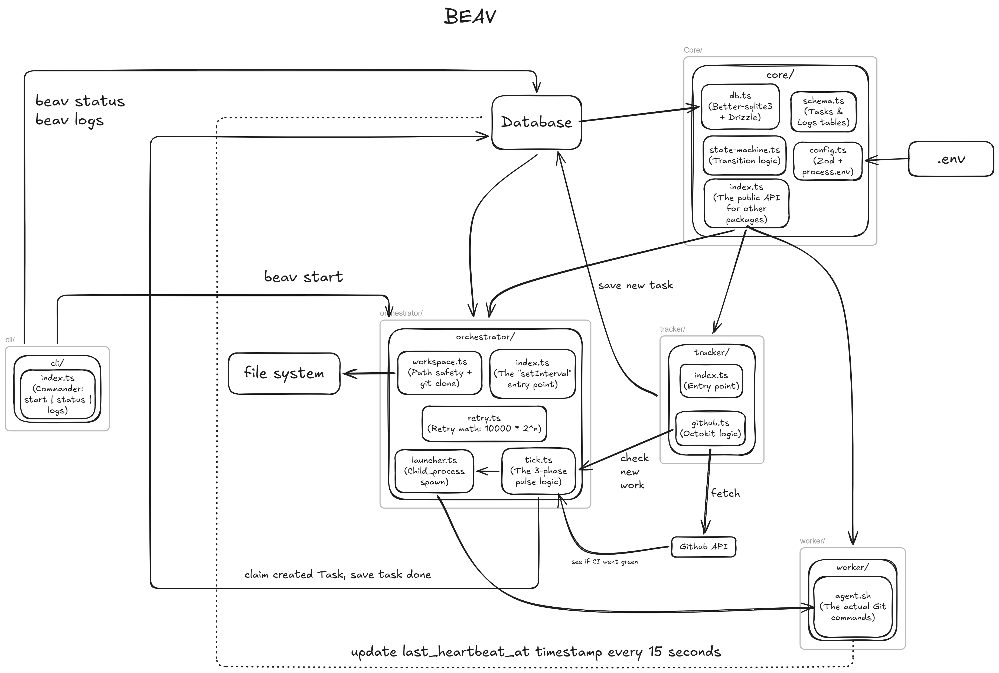
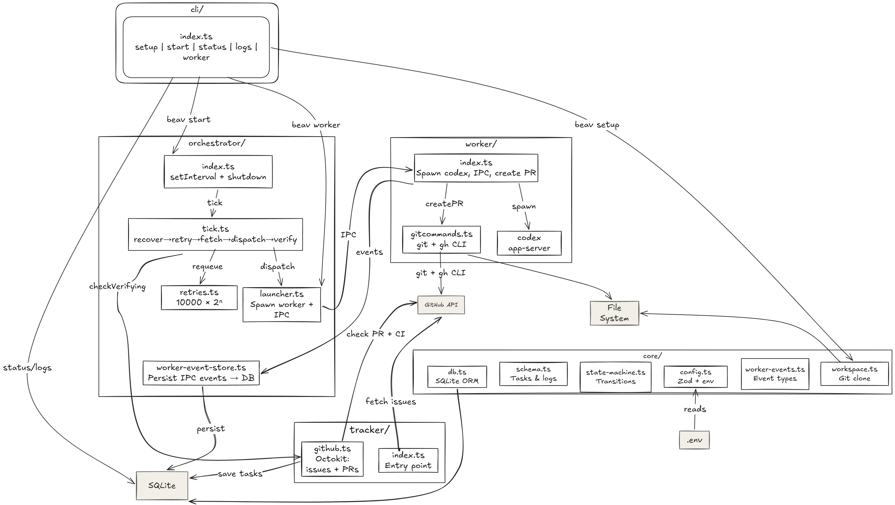
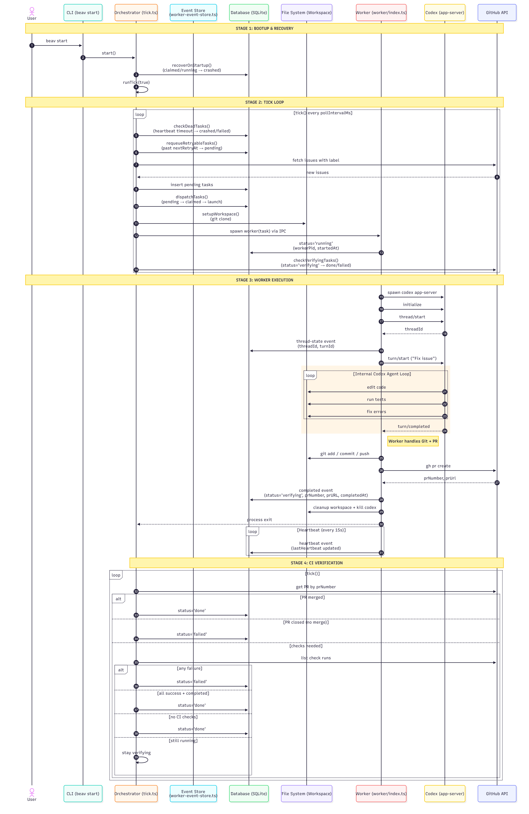

# Beav

Beav watches GitHub issues with a chosen label, assigns them to independent Node workers, runs Codex to edit a task checkout, publishes a pull request, and monitors its checks and merge status.

The parent decides what runs and what retries. Workers execute one attempt and report results. SQLite records progress.

## Architecture

```text
CLI
 |
 v
Orchestrator ---- Tracker ---- GitHub issues / PR checks
 |     |
 |     +---- Core task store ---- Drizzle ---- SQLite (WAL)
 |
 +---- Node worker 1 ---- Codex app-server
 +---- Node worker 2 ---- Codex app-server
 +---- Node worker N ---- Codex app-server
       |      |
       |      +---- stdin/stdout: newline-delimited agent RPC
       +---- git / gh: branch, commit, push, PR

Parent <---- Node IPC reports + acknowledgements ----> Workers
```

Five packages, one host:

| Package      | Responsibility                                                        |
| ------------ | --------------------------------------------------------------------- |
| core         | Shared types, configuration, persistence, lifecycle rules, workspaces |
| tracker      | GitHub API calls; no database access                                  |
| orchestrator | Scheduling, execution ownership, retries, PR lifecycle decisions      |
| worker       | Agent execution and PR publication; no database access                |
| cli          | Setup, startup, task status and saved logs                            |

## Build and run

Use Node 20 or newer, pnpm 10.33.0, Git, GitHub CLI and Codex CLI. Authenticate Git/GitHub CLI and Codex separately. Octokit uses GITHUB_TOKEN; Git pushes and gh use their own configured credentials.

```sh
corepack pnpm install
npm run build
npm run setup
npm start
```

The same root scripts work with pnpm. TypeScript compiles before execution; runtime commands use compiled JavaScript. Run the build after changing source. There is no tsx runtime or separate service startup per package.

```sh
npm run typecheck
npm test
npm run status
npm run logs -- TASK_ID
node packages/cli/dist/index.js worker TASK_ID
```

The manual worker command claims an existing pending task, prepares its workspace and waits for that worker. It rejects a task already claimed or running instead of launching a second execution. Status and logs now read the database; logs prints saved entries rather than following them continuously.

## Configuration and existing data

Setup writes packages/cli/.env. Startup explicitly loads that file without overriding existing environment variables. Importing a utility does not load configuration or initialize SQLite.

```dotenv
GITHUB_TOKEN=...
REPO_OWNER=owner
REPO_NAME=repository
ISSUE_LABEL=autofix
MAX_CONCURRENT=3
POLL_INTERVAL_MS=30000
THRESHOLD_MS=45000
```

ISSUE_TITLE remains accepted as a legacy name for ISSUE_LABEL.

Paths are resolved once, relative to packages/cli, preserving the directory used by the original root start command:

- Database: packages/cli/beav.db; override with DATABASE_PATH.
- Workspaces: packages/cli/workspaces; override with WORKSPACE_ROOT.
- Absolute overrides work independently of the command's working directory.

No existing database files are moved, merged, migrated, or deleted. If you previously ran Beav from a different directory, set DATABASE_PATH to that database and WORKSPACE_ROOT to its workspace root. Existing ULID task IDs remain valid; new tasks use UUIDs. Queue order uses createdAt, not ID ordering.

## Follow one task

Open orchestrator/src/tick.ts. A scheduler pass:

1. Fetch labeled open issues and save new tasks.
2. Detect stopped or stale executions and requeue retries whose delay has expired.
3. Calculate capacity and conditionally claim pending tasks.
4. Prepare independent checkouts concurrently and launch workers.
5. Inspect existing pull requests and CI.

Worker reports are handled asynchronously while scheduler passes run. Each child's reports are processed in order. The child receives a start message only after the parent has saved running ownership.

Open worker/src/run-task.ts. One worker:

1. Start heartbeat and timeout handling.
2. Await agent.fixIssue(task).
3. Create the branch, commit, push and PR.
4. Send one terminal result and await the parent's persistence acknowledgement.
5. Stop the agent and remove the checkout.

Protocol callbacks resolve the agent operation; they do not publish PRs. Agent progress is saved as task logs. Thread/turn identifiers remain available as existing diagnostic metadata, not as a session-resume feature.

## Task states and recovery

```text
pending -> claimed -> running -> verifying -> done
             |          |           |
             v          v           v
           crashed    failed      failed

failed / crashed -> pending, when an execution retry is allowed
```

All seven states remain declared. Existing completion behavior is preserved: a merged PR deletes its task row and cascading logs instead of retaining a done row. Successful CI alone stays verifying until merge. Verifying tasks still consume capacity. CI failure or PR closure marks failed without scheduling another coding attempt.

Worker and launch failures use the saved retry limit. Each recorded execution failure increments retryCount once; another attempt is eligible only while retryCount < maxRetries. The delay is 10 seconds times 2 raised to the new retry count. Retrying recreates the checkout and starts a new agent session.

Heartbeats run every 15 seconds. The parent starts the heartbeat timestamp when launching a worker, before the first report. Legacy null heartbeats fall back to execution timestamps. The worker timeout remains 10 minutes.

Conditional claims launch only when UPDATE ... WHERE status = 'pending' returns a row. Later reports are also checked against the originating claimedAt and retryCount and the expected status. Failure state and its diagnostic entry are saved in one transaction.

On POSIX systems each worker leads a process group. Shutdown signals the group, waits for reports/cleanup, then escalates if necessary. Crash cleanup also stops remaining group members before removing files. Terminal reports have a five-second cleanup grace period before the parent forces group shutdown. Linux startup recovery checks the saved worker's command and assignment before signaling it, to avoid killing an unrelated process that reused its PID.

## Read these eight files

Paths below are relative to packages/.

| Order | File                         | What it explains                                      |
| ----- | ---------------------------- | ----------------------------------------------------- |
| 1     | orchestrator/src/index.ts    | Explicit startup, scheduling and shutdown             |
| 2     | orchestrator/src/tick.ts     | The parent workflow and PR decisions                  |
| 3     | worker/src/run-task.ts       | The worker workflow and final cleanup                 |
| 4     | core/src/task-store.ts       | Queries, conditional ownership and persisted state    |
| 5     | worker/src/agent-client.ts   | Agent requests, replies and completion                |
| 6     | orchestrator/src/launcher.ts | Child processes, ordered reports and acknowledgements |
| 7     | tracker/src/github.ts        | Issue discovery and PR/check inspection               |
| 8     | worker/src/gitcommands.ts    | Branches, commits, pushes and PR publication          |

For a detail, follow the explicit module import. There is no application container, generic event bus, or ORM query construction in the workflows.

## Verification and limits

npm test builds the five packages and runs Node's test runner. Tests use real temporary SQLite databases, competing claim connections, real child-process pipes and IPC, and local Git repositories. GitHub and Codex responses are supplied by test fixtures. These tests do not establish live GitHub, Codex/provider, remote CI, or production behavior.

This remains a single-parent, single-host application. WAL allows reader/writer overlap and retains SQLite's single-writer constraint. Conditional claims do not make global capacity or startup recovery safe across multiple orchestrators.

Workspace checks provide path containment, not OS sandboxing. The existing Codex danger-full-access setting is retained. RPC messages retain the existing Codex envelope, which omits jsonrpc: "2.0"; strict JSON-RPC 2.0 compliance is not claimed.

External publication is not transactional with SQLite. A parent/host failure around a successful push or PR creation can still leave work requiring reconciliation. Agent instructions to run tests are not an independently enforced test gate. Issue and check fetching retain the existing first-page API behavior. Process-group cleanup is exercised on Linux; equivalent Windows descendant-process cleanup is not implemented. Recovery of a still-live worker from an earlier parent is verified through Linux /proc; other platforms require that worker to be stopped before restart.

Potential later changes, deliberately deferred: keep done-task history, release capacity during PR verification, retry failed CI, add pagination, reconcile partially published PRs, and adopt stronger execution isolation.

## Earlier architecture illustrations

These illustrations predate the readability refactor and may not match current module names.




